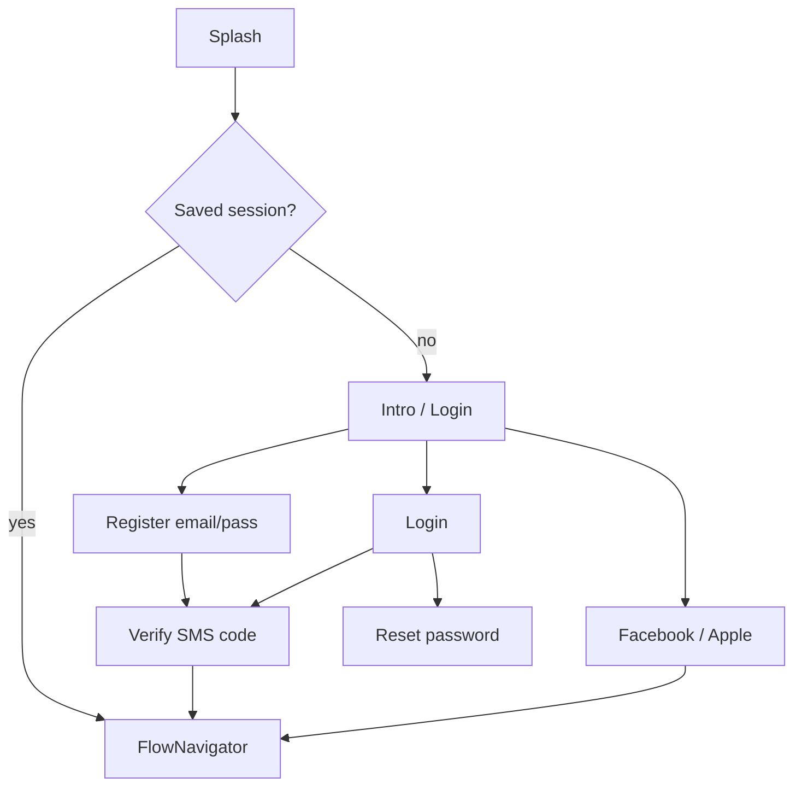
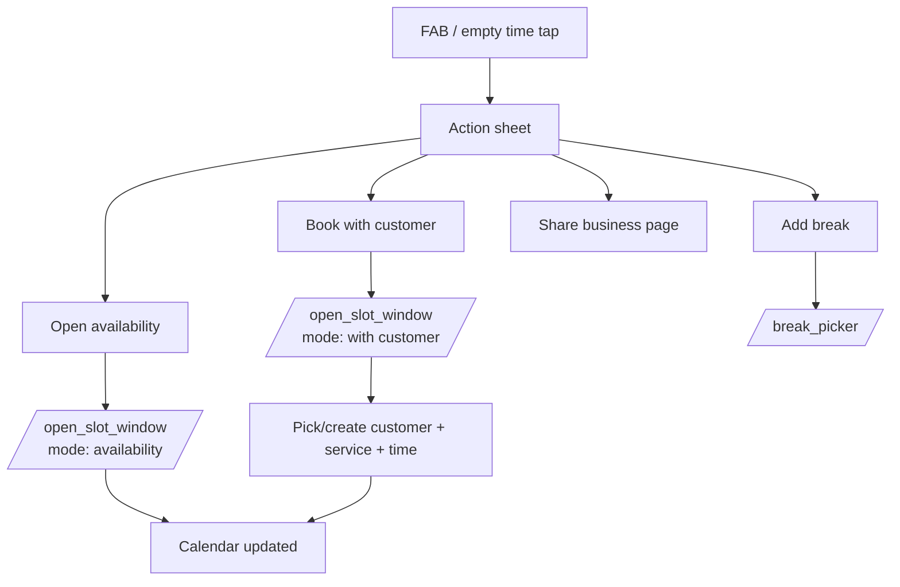
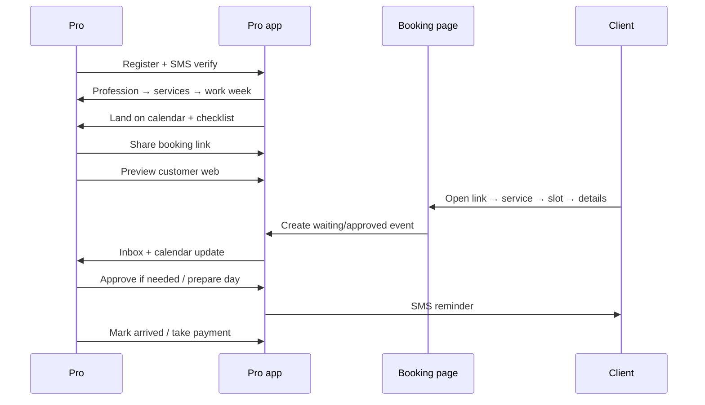

# Plannie UX & user flows

Extracted from the pro app (v7.76.9): routes, `FlowNavigator`, calendar/FAB handlers, `EventsNavigationHandler`, tour/onboarding, bottom nav.  
Client booking happens on the **public business page** (web); the app only previews it in an iframe.

---

## 1. Information architecture (pro app)

### Bottom navigation (5 tabs)

Shown only on main hubs; hidden on detail/setup screens.

| Tab | Screen | Role |
|-----|--------|------|
| Calendar | `/calendar` | Home — day/week ops |
| Insights | `/insights` | Business stats (+ waiting list entry) |
| Inbox | `/inbox` | Notifications / activity |
| Tools | `/tools` | Productivity shortcuts grid |
| Settings | `/settings2` | Account, booking prefs, team, billing |

### Global UX chrome

- Portrait mobile WebView; desktop → `/not_supported` (“scan QR for mobile”)
- Hebrew/English, RTL-aware
- Brand accent `#007aff` (Viber white-label variant `#7360f2`)
- Spinners, toasts, Materialize **bottom sheets**, Popeye-style modals, Lottie coaches
- Connectivity + “traveling / timezone” banners
- Subscription / plan pickers as global bottom sheets (PayPal)

### Tools hub tiles

**Booking page:** Share page · Edit page (branding)  
**Productivity:** Payments · Customers · Mass message · Services · Campaigns (“smart revenue”) · Waiting list · Punch cards (flagged) · Amit (partner)  
**Other:** Excel report · Calendar sync  
(Nayax POS tile for some IL payment users)

---

## 2. Personas & surfaces

```text
┌─────────────────────┐     share link      ┌──────────────────────────┐
│  Pro mobile app     │ ─────────────────► │  Public booking page     │
│  (this APK)         │   preview iframe   │  (web / customer web)    │
└─────────────────────┘ ◄─── bookings ──── └──────────────────────────┘
         │                                            │
         │ SMS / push / WhatsApp deep link            │ deposit / confirm
         ▼                                            ▼
   Inbox + calendar updates                    Client phone/browser
```

- **Pro (master):** owns business, branding, billing, stations  
- **Pro (station/child):** own calendar, limited tools  
- **Client:** never uses this APK successfully — books via link/PWA/web  

---

## 3. Auth & entry



Screens: `/splash` → `/intro` or `/login` / `/register` / `/verify` / `/reset_pass`.

---

## 4. Activation / onboarding (`FlowNavigator`)

Gate order (must complete before “boarded”):

1. **Profession** not set → onboarding form (`/form` / profession picker)  
2. **Username** if `shouldAskForUserName`  
3. **Email** if `shouldAskForEmail`  
4. **Services** empty → profession templates → pick/create services → `createServices`  
5. **Work week** (v2): no `availabilityOpenUntil` → `/work_week`  
6. **Windows** (v1 legacy): auto-creates a 9h “working day” window if none  
7. Else → **Calendar**

Post-calendar **checklist** (steps bar on calendar):

| Step | Done when |
|------|-----------|
| Share with clients | `shareLinkClicked > 0` |
| View business page | `userSawCustomerWeb` |
| Brand business page | branding edited |
| Set availability | tour forces open-slot coaching |
| Set services | always marked complete once listed |

**Tour / feature exposure ladder** (modals & hints after calendar):  
open slot coach → branding modal → payments modal (non-IL) → subscription modal → terms → waiting-list notice → insights hint → workflows hint → campaigns hint → finished.

**Work week UX (v2):** tabs *Weekly hours* / *Extensions*; pick days; edit shift start/end; optional slot algorithm; save.

---

## 5. Calendar — primary UX

### Header / chrome

- Prev / next period  
- **Today** button  
- View switcher bottom sheet (day / week / month patterns)  
- Station switcher (multi-staff)  
- Search  
- Work-week bubble (v2)  
- FAB / plus affordances  

### Calendar object types (by `status`)

| Status | Meaning | Tap opens |
|--------|---------|-----------|
| 0 | Availability / open window | Opened-slot screen (book into / edit window) |
| 1 | Waiting approval | Waiting-approval screen |
| 2 | Approved appointment | Approved-slot detail |
| 3 | Cancelled (or break styling) | Cancelled-slot screen |
| 5 | (internal) | Returns to calendar |
| 100/101 | External calendar event | External-event screen |

### Create flows (FAB / empty tap)



- **Open availability:** paint bookable window (often ~8h block from click; v2 also work-week driven)  
- **Book with customer:** same shell in “schedule with customer” mode → customer + service + duration → creates pending/approved appointment  
- **Break:** break picker  
- Past taps blocked: “can’t create events in the past”  
- Drag/resize appointments (move/resize APIs); repeat/series prompts on some creates  

### Open-slot window (`/open_slot_window`)

Shared composer for availability **or** booking:

- Time range  
- Active services for the window  
- Optional customer (pick existing / create)  
- Service + duration  
- Breaks inside range  
- Recurrence (repeat manager)  
- Punch-card attach when enabled  
- Save → calendar  

### Waiting approval (`/waiting_approval`)

Client requested a slot (when auto-confirm off):

- See date/time, service, customer  
- Switch station (if team)  
- **Approve** / **Decline**  
- Contact: call, email, SMS, WhatsApp (device deep links)  
- Open customer profile  

### Approved appointment (`/approved_slot`)

Daily ops surface:

- Customer info + history (past/future with same phone)  
- Contact: SMS / WhatsApp with **message templates**  
- Send reminder / send another reminder  
- **Mark as arrived**  
- Edit price / take payment / invoice / refund (payments stack)  
- Cancel (current / future / all in series)  
- Move / reschedule  
- Meeting summary / notes (incl. vertical partner flows)  
- Post-scheduling workflow config lives on service (`/postScheduling`)  

### Cancelled / external

- Cancelled: view + optionally rebook path  
- External (Nylas/Google): read-only-ish overlay on calendar  

---

## 6. Client booking flow (public page)

Not implemented inside the APK UI (iframe preview only). Inferred product flow:

```text
Open share link / branded page
  → Browse services (+ remote/Meet badge if remote)
  → Optional staff/station
  → Pick date → available slot
  → Enter name / phone / email (+ extra fields if configured)
  → Optional deposit / payment
  → Submit
       ├─ autoConfirmation ON  → status 2 (Approved) + SMS
       └─ autoConfirmation OFF → status 1 (Waiting) → pro approves
  → Reminders per pro settings (SMS/email; address concat options)
  → Cancel/reschedule per cancel-threshold policy
```

Pro mirrors this via **Customer Web** preview (`/customer_web`) and **Share** (native share + copy link).

---

## 7. Customers / CRM flows

```text
Tools → Customers
  → List / search
  → Single customer (history, punch cards, notes)
  → Edit / create customer
  → Import contacts (device)  [/customersImport]
  → Bulk message mode (mass SMS/email)
  → Pending customers intention (from notifications)
```

From booking composer: **Pick customer** → create if missing → back to open-slot with customer attached.

---

## 8. Messaging & retention

| Flow | Path |
|------|------|
| Inbox triage | `/inbox` → open related event/customer |
| Client message templates | Settings → customer messages |
| Reminder policy | Settings → clients reminders (+ “reminders sent”) |
| Campaigns | Tools → campaign manager |
| Birthday automations | Settings toggles (SMS/email) |
| Post-visit message | Service → post-scheduling workflow |
| WhatsApp/SMS to client | From appointment detail (opens native apps) |

---

## 9. Payments & monetization UX

**SaaS (pro pays Plannie)**  
- Trial → plan bottom sheet → PayPal subscribe  
- Settings → subscription details / cancel / SaaS invoices  
- Soft/hard paywall when restricted (`blockUser` / pick-plan modal)

**Client payments (pro collects)**  
```text
Tools → Payments
  → Dashboard
  → Create merchant / KYC form (multi-step)
  → Connect Hyp / EasyCount / other
  → Per-service deposit on/off
  → On appointment: charge / invoice / refund
```

**Punch cards**  
Templates → attach to client → redeem on booking → instance detail / refund.

---

## 10. Team (stations)

```text
Settings / Master
  → Station list
  → Create/edit station
  → Pair / unpair child accounts
  → Calendar station switcher + multi-resource master view
  → Per-station work week
```

---

## 11. Settings map (pro configuration)

High-traffic settings destinations:

- Business profile / account details  
- Booking page preview + branding  
- Calendar preferences (interval between slots, how far ahead bookable, auto-confirm, auto-reopen on cancel, cancel threshold hours)  
- Customer messages & reminders  
- Notifications  
- Language & region  
- Calendar sync (Nylas/Google)  
- Payments / invoices providers  
- Subscription & referrals  
- About / delete account  

---

## 12. End-to-end “happy path” (new pro)



---

## 13. UX patterns worth copying (behavior, not pixels)

1. **Calendar is home** — everything else is a spoke.  
2. **Activation checklist** on the home screen until share + page viewed.  
3. **One composer** (`open_slot_window`) for both “open hours” and “book client”.  
4. **Status-driven detail screens** instead of one generic event editor.  
5. **Native channel handoff** (SMS/WhatsApp) from appointment context with templates.  
6. **Progressive feature tours** (waiting list, workflows, campaigns) after core activation.  
7. **Profession templates** collapse blank-canvas setup.  
8. **Auto-confirm as a single switch** that changes the whole client→pro handshake.

## 14. UX anti-patterns to avoid

1. No desktop pro surface.  
2. Consumer installs pro app → profession onboarding (wrong persona).  
3. Heavy modal/tour stack after first calendar visit.  
4. Availability creation that feels manual (large windows, weak auto-packing).  
5. WhatsApp only as `openWhatsApp(...)` deep link, not in-product messaging.

---

## Screen index (pro app routes)

~94 routes registered. Core clusters:

- **Auth:** splash, intro, login, register, verify, reset_pass  
- **Onboarding:** form, set_profession, set_user_name, set_email, set_services, set_service, work_week, branding  
- **Calendar ops:** calendar, open_slot_window, opened_slot, waiting_approval, approved_slot, cancelled_slot, break(_picker), appointment_picker, extension, external_event, search  
- **CRM:** customers, single_customer, edit_or_create_customer, pick_customer, customersImport  
- **Growth:** inbox, campaigns, waiting_list, insights, referrals, tools  
- **Money:** payments*, create_merchant, connect_*, punchcards*, transactions, saas_invoices, cancel_subscription  
- **Team:** master, station, create_or_edit_station  
- **System:** settings2 + satellites, calendarSync, webview, customer_web, not_supported  

Full route table lives in decompiled `js/routesManager.js` (gitignored binary tree).
